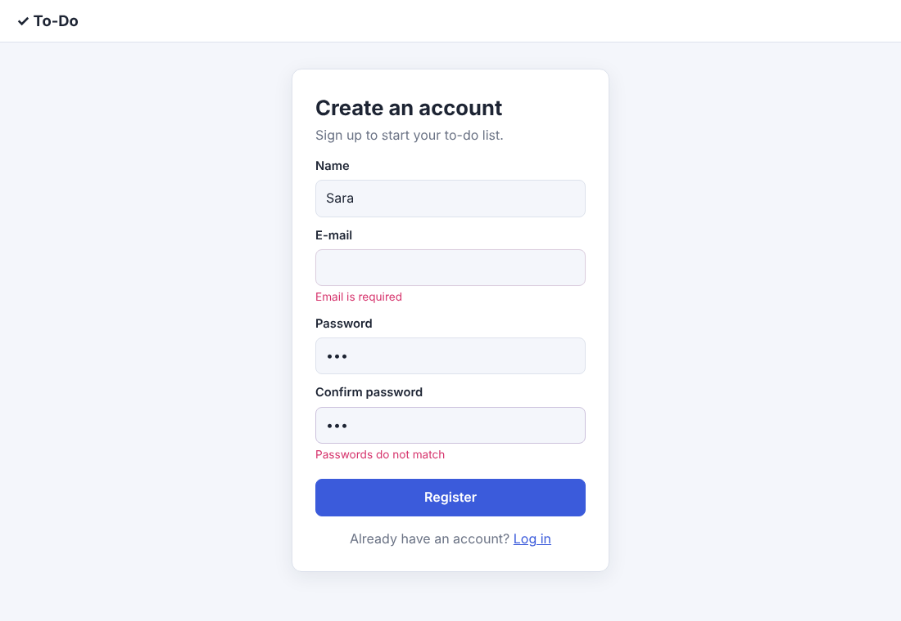
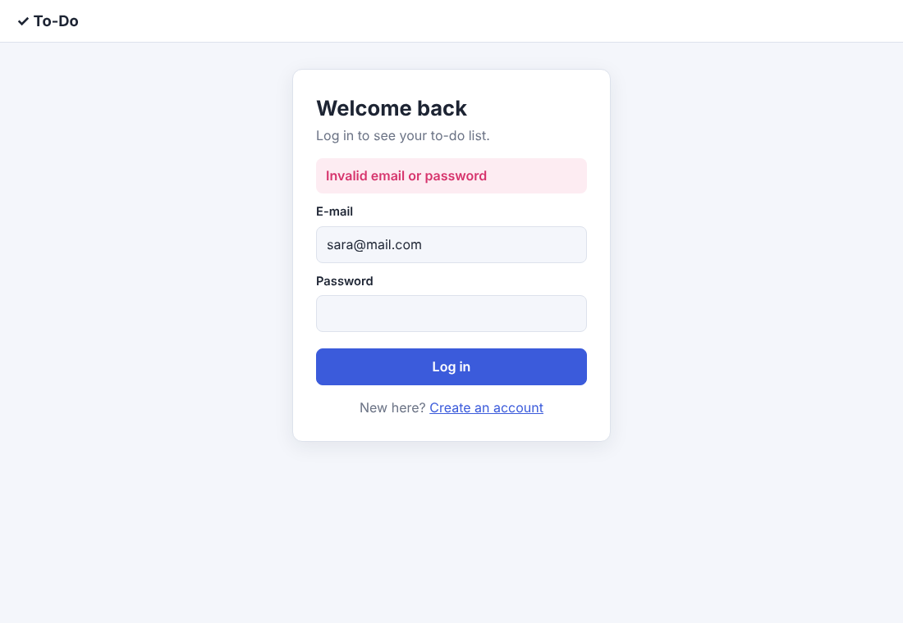
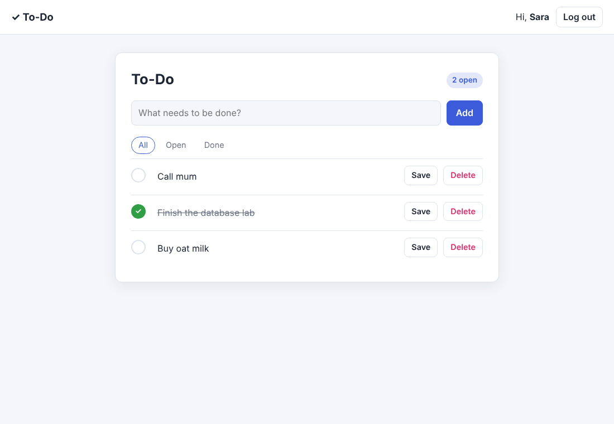
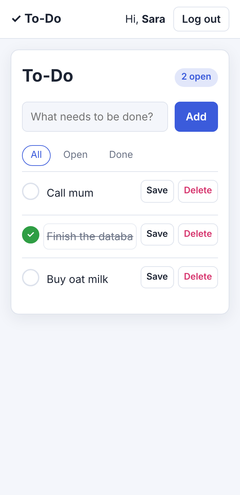
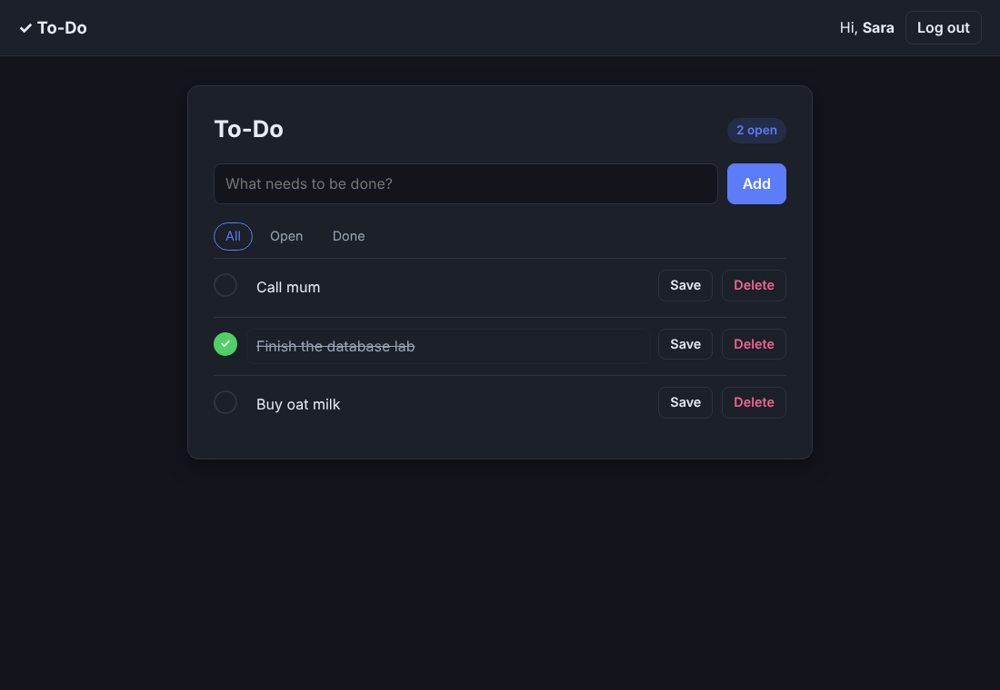

# DB Lab 2 — Login & To-Do Application

A small web application where users sign up, log in, and manage their own private to-do list.
Built for *Introduction to Database Systems*, Alexandria National University, Fall 2026.

## 1. Team

| Name | ID | Contribution |
|------|----|--------------|
|Amr Khalid Mohamed|2304120 |i made the whole repo except the frontend and tried in the backend but it looked bad so i gave it to an ai to improve it|


## 2. Technology

| Part | Technology |
|------|------------|
| Back end | Python 3 + Flask (server-side sessions via signed cookie), PyMySQL (plain SQL with `%s` parameters, no ORM), bcrypt |
| Front end | Server-rendered Jinja templates, plain HTML/CSS (own stylesheet, responsive, dark mode), plain JavaScript for validation |
| Database | MySQL 8 — database `registration`, tables `users` and `todos` |
| Tests | pytest (Flask test client against the real database) |

## 3. How to run it (from an empty machine)

1. **Install** Python 3.10+, MySQL Server 8 and Git.
2. **Get the code**
   ```bash
   git clone <repository-url>
   cd db-lab2-<names>
   ```
3. **Build the database** (re-runnable; it drops and recreates `registration`):
   ```bash
   mysql -u root -p < database/schema.sql
   ```
   (or open `database/schema.sql` in MySQL Workbench and run it).
4. **Install the Python packages**
   ```bash
   python -m venv .venv
   # Windows: .venv\Scripts\activate      macOS/Linux: source .venv/bin/activate
   pip install -r requirements.txt
   ```
5. **Configure** — copy `.env.example` to `.env` and put your MySQL user/password and any long random `SECRET_KEY`:
   ```bash
   cp .env.example .env        # Windows: copy .env.example .env
   ```
6. **Start the server**
   ```bash
   python app.py
   ```
7. **Open** <http://127.0.0.1:5000> in the browser.

Optional — run the automated tests (they empty the tables, so run `schema.sql` again afterwards if you want a clean start):
```bash
pip install pytest
python -m pytest -q
```

## 4. Features

| # | Requirement | Where |
|---|-------------|-------|
| R1 | Register (name, e-mail, password, confirm). Duplicate e-mail → **Email Already Exists** (MySQL error 1062 from `UNIQUE(email)`). After registering the user is logged in and sent to the list. | `app.py` → `register()` |
| R2 | Login; wrong e-mail and wrong password both show **Invalid email or password**. Logout clears the session. | `login()`, `logout()` |
| R3 | The list is private: `@login_required` redirects visitors to `/login`; the list query filters by the session's `user_id`, newest first. | `login_required`, `todos()` |
| R4–R7 | Add, edit title, mark done / not done, delete (with an “Are you sure?” confirm). | `add_todo()`, `edit_todo()`, `toggle_todo()`, `delete_todo()` |
| R8 | Same rules in the browser (`static/validate.js`) and on the server, with the exact messages. On a server error the page is shown again and the database is not touched. Works with JavaScript off. | `validate.js`, `register()`, `login()`, `validate_title()` |
| R9 | bcrypt hashes (cost 12, `$2b$12$…`), only the queries from the handout, always parameterised; `user_id` is always taken from the session, never from a form. | `app.py` |
| R10 | One consistent style, responsive down to 360 px, inline error messages, crossed-out + green tick for done items, friendly empty state, “Hi, name” + Log out, styled error pages (no stack traces). | `static/style.css`, `templates/` |

**Bonus:** filters (All / Open / Done), counter of open to-dos, automatic dark mode (follows the OS setting), automated tests (`tests/test_app.py`, 10 tests).

### The SQL used by the application

```sql
INSERT INTO users (email, name, password_hash) VALUES (%s, %s, %s);
SELECT user_id, name, password_hash FROM users WHERE email = %s;
SELECT todo_id, title, is_done, created_at FROM todos WHERE user_id = %s ORDER BY todo_id DESC;
INSERT INTO todos (user_id, title) VALUES (%s, %s);
UPDATE todos SET title = %s WHERE todo_id = %s AND user_id = %s;
UPDATE todos SET is_done = %s WHERE todo_id = %s AND user_id = %s;
DELETE FROM todos WHERE todo_id = %s AND user_id = %s;
```

## 5. Screenshots

| Register with error messages | Login (wrong password) |
|---|---|
|  |  |

| List with to-dos (one done) | Phone-sized window (360 px) |
|---|---|
|  |  |

Dark mode (bonus):



## 6. Questions

**(a) Why do UPDATE and DELETE contain `AND user_id = ?`, and what changes if you remove it?**
The `todo_id` comes from the browser (it is in the form's URL), so anybody can change it and send the number of a to-do that belongs to another user. `AND user_id = ?` is filled with the id of the logged-in user from the session, so the statement only matches rows that belong to that user; for someone else's to-do it changes zero rows. Without it, any logged-in user could rename, tick or delete every to-do in the table just by trying different numbers (an *insecure direct object reference*).

**(b) What happens if you insert a to-do for a `user_id` that does not exist, and which constraint of the lecture is that?**
MySQL refuses the insert with error **1452** *“Cannot add or update a child row: a foreign key constraint fails”*, because `todos.user_id` is a foreign key referencing `users.user_id`. This is the **referential integrity constraint**: a foreign-key value must either match an existing primary-key value in the referenced table (or be NULL, which `NOT NULL` forbids here). The test `test_foreign_key_rejects_unknown_user` checks this.

**(c) Why do you store a hash and not the password?**
If the database is ever leaked (backup, SQL injection elsewhere, an insider), plain passwords would be read directly and reused on the users' other accounts. A bcrypt hash is one-way: the server can still check a typed password with `bcrypt.checkpw`, but cannot turn the hash back into the password. bcrypt adds a random salt (equal passwords give different hashes, so no precomputed rainbow tables) and is deliberately slow (cost 12), which makes guessing millions of passwords expensive. MD5/SHA are too fast for this.

**(d) The `name` column is NOT NULL: why did you still need your own check for an empty name?**
`NOT NULL` only forbids the special value NULL. An empty string `''` (or `'   '`) is a real value, so MySQL accepts it happily. A form field that was left empty is sent as `''`, not NULL, so the database would store a user with no name. Only our own check (after `strip()`) can refuse it and show **Name is required**.

## Project structure

```
db-lab2/
├── README.md
├── .gitignore            # lists .env
├── .env.example          # fake values only
├── requirements.txt
├── app.py                # Flask server: routes, validation, SQL
├── database/schema.sql   # DDL: both tables, re-runnable, no data
├── templates/            # base, register, login, todos, error
├── static/               # style.css, validate.js
├── tests/test_app.py     # automated tests (bonus)
└── screenshots/
```
